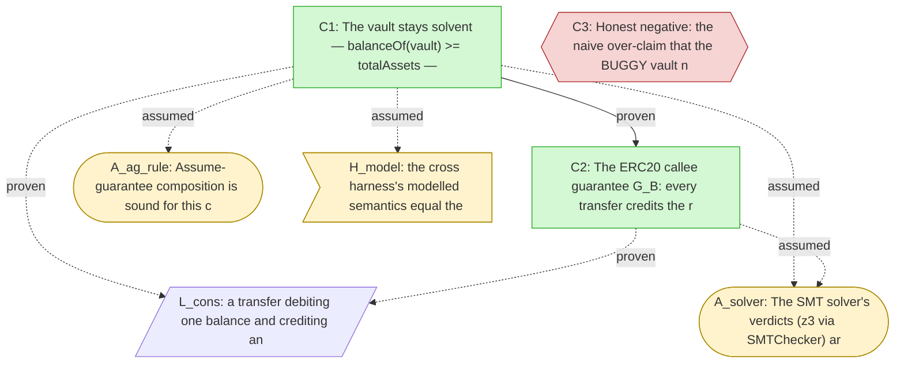

# Assurance audit — VaultAssetAG

> **AUTO-GENERATED** from `assurance_graph.yaml` + `trusted/ledger.yaml`. Do not edit; regenerate with `python -m assurance.render_audit <pkg>`.

> Cross-contract solvency holds for the vault composed with an honest ERC20. The mined weakest-sufficient guarantee is `at_least`; candidates `monotone`, `upper_only`, `irrelevant` were solver-refuted as insufficient (see measurement/artifacts/cross_ag__triage.json). The guarantee is not assumed on faith — it is discharged by C2.

## TL;DR for the auditor

- **Top claim C1** — The vault stays solvent — balanceOf(vault) >= totalAssets — when composed with an ERC20 that honours the callee guarantee. — **✅ proven**
  - exact formula: `vaultBal >= totalAssets`
- **Top claim C3** — Honest negative: the naive over-claim that the BUGGY vault never mints a share from nothing is REFUTED — deposit(0) mints one share against zero assets. — **❌ refuted (witness)**
  - exact formula: `totalShares == totalAssets`
- You are trusting **3 leaf assumption(s)** + **1 Lean theorem(s)** (kernel-checked). Decide each below.
- Re-check everything, backwards, without the session:
  ```
  python -m assurance.verify_package pilot-vaultasset-2026-06-26 --replay
  ```

## Claim graph (GSN projection)



Legend: `[ ]` claim · `[/ /]` Lean theorem (kernel) · `([ ])` assumption · `> ]` harness-faithfulness. Solid arrow = claim→claim; dotted = claim→leaf.

## Claims (walk top-down)

### C1 — ✅ proven

The vault stays solvent — balanceOf(vault) >= totalAssets — when composed with an ERC20 that honours the callee guarantee.

- **formal:** `vaultBal >= totalAssets`
- **shape:** quantified-over-mapping · **engine:** solc 0.8.35 chc z3
- **evidence (SMT):** `evidence/smt/C1__VaultAssetAG__cross.sol`
- **reproduce:** `solc --model-checker-engine chc --model-checker-targets assert --model-checker-solvers z3 --model-checker-timeout 20000 <harness>`
- **depends on:**
    - `[proven]` → **C2** (claim): the ERC20 callee actually delivers the guarantee the caller assumed (B ⊨ G_B)
    - `[proven]` → **L_cons** (lean_theorem): the tracked-sum ghost is faithful: a transfer preserves Σ balance (Lean kernel)
    - `[assumed]` → **A_ag_rule** (assumption): assume-guarantee composition is sound for this single-call, non-reentrant frame
    - `[assumed]` → **A_solver** (assumption): the SMT proof of C1 is trusted (z3/SMTChecker), not re-checked by the Lean kernel
    - `[assumed]` → **H_model** (harness_faithfulness): the cross harness models the deployed bytecode (unverified — the moat)

### C2 — ✅ proven

The ERC20 callee guarantee G_B: every transfer credits the recipient by at least `amount` (callee-side form of the mined `vaultBal_post >= vaultBal + assets`).

- **formal:** `vaultBal_post >= vaultBal + assets`
- **shape:** temporal-2state · **engine:** solc 0.8.35 chc+bmc z3
- **evidence (SMT):** `evidence/smt/C2__MiniERC20Delta.sol`
- **reproduce:** `solc --model-checker-engine all --model-checker-targets assert --model-checker-solvers z3 --model-checker-timeout 20000 <harness>`
- **depends on:**
    - `[proven]` → **L_cons** (lean_theorem): Σ-conservation underpins the per-transfer delta the guarantee asserts
    - `[assumed]` → **A_solver** (assumption): the SMT proof of C2 (chc+bmc) is trusted, not re-checked by the Lean kernel

### C3 — ❌ refuted (witness)

Honest negative: the naive over-claim that the BUGGY vault never mints a share from nothing is REFUTED — deposit(0) mints one share against zero assets.

- **formal:** `totalShares == totalAssets`
- **shape:** stateless · **engine:** solc 0.8.35 chc z3
- **witness:** `{'assignments': {'totalAssets': '0', 'totalShares': '1'}, 'transaction_trace': ['__Harness.constructor()', 'State: totalAssets = 0, totalShares = 0', 'MiniVaultBuggy.deposit(0)', 'State: totalAssets = 0, totalShares = 1', '__Harness.__check_invariant()', '31 |         assert(totalShares == totalAssets);']}`
- **evidence (SMT):** `evidence/smt/C3__MiniVaultBuggy__harness.sol`
- **reproduce:** `solc --model-checker-engine chc --model-checker-targets assert --model-checker-solvers z3 --model-checker-timeout 20000 <harness>`

## Trusted base — the leaves you must accept

### Lean theorems (discharged by the Lean kernel)

- **L_cons** — a transfer debiting one balance and crediting another by the same amount preserves the pair sum — so the tracked-sum ghost == totalSupply is faithful
  - `(a - amt) + (b + amt) = a + b   (and the Σ-over-Finset form)`
  - theorem `Erc20.transfer_pair_sum_preserved` in `evidence/lean/L_cons__Basic.lean` — build: **ok** (proven)

### Assumptions (taken on faith — decide each)

- **A_ag_rule** — Assume-guarantee composition is sound for this configuration.
  - formal: `(A ⊨ I_A | G_B) ∧ (B ⊨ G_B) ⟹ (A∘B ⊨ I_A), single external call, no reentrancy`
  - **why assumed:** The composition meta-rule is applied, not proven here. It is sound for a single external call with a non-reentrant frame (Finding 0004); a general proof is a separate track.
  - **risk if false:** If reentrancy or multiple interleaved external calls are possible, the caller proof under havoc+require(G_B) may not transfer to A∘B.
- **A_solver** — The SMT solver's verdicts (z3 via SMTChecker) are sound.
  - formal: `trust(z3 4.16.0 + SMTChecker CHC/BMC) — no independent kernel re-check`
  - **why assumed:** The CHC/BMC proofs of C1 and C2 are taken on the solver's word. lean-smt proof reconstruction (DoD #3) would replace this leaf with a Lean-kernel re-check; that experiment is time-boxed and tracked separately. Until then, this leaf is visible, not hidden.
  - **risk if false:** A solver soundness bug would make a 'proven' claim false. Mitigated by determinism and the witness-bearing refutations, but not eliminated.

### Harness faithfulness (model ↔ deployed bytecode — the moat)

- **H_model** — target `VaultAssetAG (vault) ∘ MiniERC20 (asset)` — status: **unverified**
  - claim: the cross harness's modelled semantics equal the deployed EVM bytecode
  - evidence: not measured for this pilot (diff-fuzz N runs is the intended evidence) (`n/a`)

---
*The product is the epistemic claim above plus this bounded, re-checkable list of assumptions. Accept the leaves, or reject one — that is the whole audit.*
